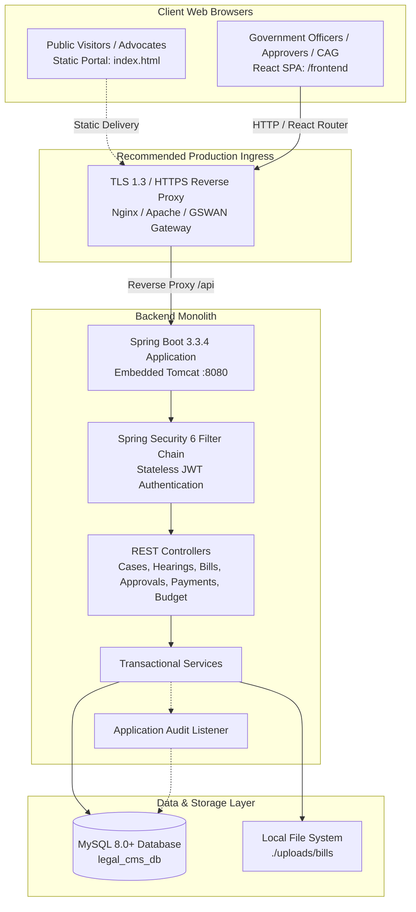
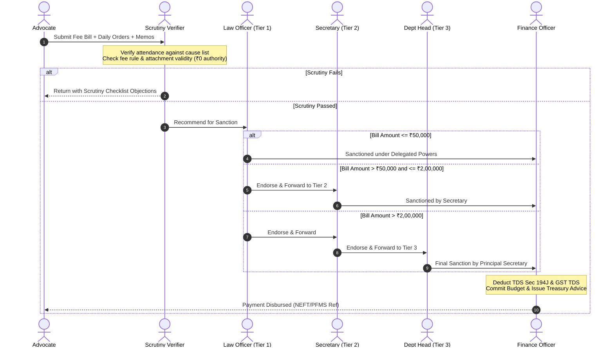

# Gujarat Legal Case Management System (LCMS) & Department Portal
### MVP Blueprint & Prototype Implementation for Problem Statement: PS000024

[](https://github.com)
[](https://spring.io)
[-6DB33F.svg?logo=springboot&logoColor=white)](https://spring.io/projects/spring-boot)
[](https://react.dev/)
[](https://www.mysql.com/)
[-yellow.svg)](https://jwt.io/)
[-green.svg)](https://gigw.gov.in)

> **⚠️ DISCLAIMER & PROJECT STATUS**  
> This repository contains a **proof-of-concept prototype and MVP blueprint implementation** built strictly for research, academic evaluation, and architectural demonstration under **Problem Statement PS000024**.  
> **This is NOT an official Government of Gujarat application or production deployment.** It is not connected to live government networks (GSWAN, State Data Centre, eCourts, or PFMS). Any government branding, department names, or emblem references are utilized solely in accordance with the design guidelines of the supplied problem brief.

---

## 📑 Table of Contents
1. [Project Overview](#-project-overview)
2. [Current Architecture (As-Built)](#-current-architecture-as-built)
3. [Business Workflow & Authority Delegation](#-business-workflow--authority-delegation)
4. [Implemented Capabilities vs. Mock/Stubs](#-implemented-capabilities-vs-mockstubs)
5. [Directory Layout (Portable Paths)](#-directory-layout-portable-paths)
6. [Local Development & Setup Guide](#-local-development--setup-guide)
7. [Demo Accounts & Test Credentials](#-demo-accounts--test-credentials)
8. [API Endpoints Reference](#-api-endpoints-reference)
9. [Security Posture & Critical Vulnerabilities](#-security-posture--critical-vulnerabilities)
10. [Business Logic & Concurrency Realities](#-business-logic--concurrency-realities)
11. [Production Readiness & Engineering Roadmap](#-production-readiness--engineering-roadmap)
12. [Compliance, DPDP Act 2023 & Hosting Strategy](#-compliance-dpdp-act-2023--hosting-strategy)

---

## 📌 Project Overview

The **Gujarat Legal Case Management System (LCMS)** addresses the operational and financial challenges of tracking government litigation across courts in Gujarat. The end-to-end scope bridges litigation event tracking with advocate fee voucher settlement and budgetary accounting:

$$\text{Case Inception} \longrightarrow \text{Hearing Listing} \longrightarrow \text{Advocate Attendance} \longrightarrow \text{Fee Bill Submission} \longrightarrow \text{Scrutiny} \longrightarrow \text{Sanction} \longrightarrow \text{Disbursement} \longrightarrow \text{Audit}$$

The repository consists of two integrated components:
1. **Public Citizen & Advocate Portal (`./index.html`)**: A responsive static HTML/CSS/JS portal incorporating GIGW (Guidelines for Indian Government Websites) accessibility patterns, high-contrast toggle, font sizing, and bilingual English/Gujarati content.
2. **Internal Management Web Application (`./frontend` & `./backend`)**: A Spring Boot and React application providing role-based portals for legal officers, standing counsels, scrutiny verifiers, sanctioning authorities, treasury finance officers, and statutory auditors.

---

## 🏛️ Current Architecture (As-Built)

The system is built as a **Modular Monolith** with a single backend service communicating with a single-page React frontend and a relational database.



### Architectural Realities:
* **Monolith, Not Microservices**: The backend is packaged as a single deployable `.jar` artifact (`legal-case-management-1.0.0-SNAPSHOT.jar`).
* **Transport Security**: In local development, traffic runs over plain `http://localhost:8080` and `http://localhost:3000`. Production deployment strictly mandates HTTPS/TLS 1.3 reverse proxy termination.
* **Storage**: Document uploads (court orders, fee vouchers) are currently written to a local filesystem folder (`./uploads/bills`), requiring migration to object storage for production clusters.

---

## ⚖️ Business Workflow & Authority Delegation

### Financial Powers Delegation Matrix (DFPR)

To prevent ambiguity between **verification** (scrutiny) and **sanction** (financial authority):

| Stage | Role Name | Function | Financial Sanction Limit | Actions Available |
| :--- | :--- | :--- | :--- | :--- |
| **0. Claim** | Advocate / Counsel | Prepares and submits fee claim with hearing memos | None | Submit, Re-submit, Withdraw |
| **1. Scrutiny** | Bill Scrutiny Verifier | Audits documents, attendance orders, fee rates | **₹0 (No financial power)** | Recommend, Raise Query, Object |
| **2. Tier 1 Sanction** | Designated Law Officer | Section-level financial sanction | **Up to ₹50,000** | Sanction, Return, Forward to Tier 2 |
| **3. Tier 2 Sanction** | Sanctioning Authority / Secretary | Mid-tier statutory financial sanction | **Up to ₹2,00,000** | Sanction, Return, Escalate to Tier 3 |
| **4. Tier 3 Sanction** | Department Head / Pr. Secretary | Highest departmental financial sanction | **Above ₹2,00,000 (Unlimited)** | Final Sanction, Reject |
| **5. Treasury** | Finance & Disbursement Officer | Generates bill voucher, records TDS & release | Disbursement Execution | Release Payment, Hold, Adjust |



---

## 🔍 Implemented Capabilities vs. Mock/Stubs

To provide complete transparency on what is functioning versus what is currently stubbed:

| Module | Implemented Features (Backend + UI) | Prototype Stubs / Planned Roadmap |
| :--- | :--- | :--- |
| **Case Register** | Full CRUD, Department & OIC assignment, status tracking, court classification. | Direct bi-directional API sync with eCourts / CIS. |
| **Hearings & Attendance** | Hearing scheduler, effective/non-effective logging, advocate assignment. | Automated parsing of Gujarat High Court PDF Daily Cause Lists. |
| **Fee Bill Management** | Itemized claim calculation based on fee schedule rates, voucher upload. | Automated OCR text extraction from uploaded court order PDFs. |
| **Workflow Engine** | Database-driven stage transitions, approval inbox, reject/return remarks. | Dynamic BPMN 2.0 orchestration engine (e.g., Camunda/Flowable). |
| **Payment Register** | Treasury payment entry, cheque/NEFT reference capture, basic TDS recording. | Live integration with State Cyber Treasury (e-Kuber) or PFMS APIs. |
| **Budget Control** | 6-level head tracking (Allocated, Committed, Spent, Free Balance). | Automated interface with IFMS (Integrated Financial Management System). |
| **Audit Trail** | Relational `audit_events` table recording actor, action, timestamp, entity. | Cryptographic hash-chaining, Merkle tree sealing, or WORM storage. |
| **Notifications** | In-app notification center and dashboard alert indicators. | SMS gateway (C-DAC / NIC) and transactional SMTP email delivery. |
| **Citizen Portal** | Semantic HTML5, bilingual switch (EN/GU), font-scaler, contrast toggle. | Dynamic Headless CMS for non-technical administrative content updates. |

---

## 📂 Directory Layout (Portable Paths)

```text
./
├── README.md                           # Comprehensive architectural & operational blueprint
├── index.html                          # Public Citizen & Advocate Portal (GIGW styled)
├── style.css                           # Public Portal Stylesheet (Responsive, Contrast Modes)
├── script.js                           # Public Portal Accessibility & Tab Scripts
│
├── frontend/                           # React 18 + Vite Single Page Application
│   ├── package.json                    # Frontend dependencies (React, Router, Vite)
│   ├── vite.config.js                  # Dev server & reverse proxy configurations
│   ├── index.html                      # SPA entry template
│   └── src/
│       ├── main.jsx                    # React bootstrapping
│       ├── App.jsx                     # Route declarations & role guards
│       ├── index.css                   # Custom CSS design system
│       ├── context/                    # Authentication state & role context
│       ├── services/
│       │   └── api.js                  # REST API client (*Includes toggleable dev mock fallbacks*)
│       ├── components/                 # Reusable UI widgets, layout, navigation & badges
│       └── pages/                      # Role-specific application views
│           ├── DashboardPage.jsx       # Consolidated KPI analytics
│           ├── LoginPage.jsx           # Login interface with quick role switcher
│           ├── cases/                  # Litigation case registry
│           ├── hearings/               # Court hearing boards & attendance
│           ├── bills/                  # Bill submission & scrutiny review
│           ├── approvals/              # Financial sanction workflows
│           ├── payments/               # Payment register & disbursements
│           ├── budget/                 # Budget head monitoring & allocation
│           ├── reports/                # Audit, Advocate, Court & Fiscal Year reports
│           ├── notifications/          # System alerts & SLA warnings
│           ├── audit/                  # Audit log viewer
│           └── admin/                  # System masters (Courts, Users, Fee Rules, Workflows)
│
└── backend/                            # Spring Boot 3.3.4 (Java 21) REST Backend
    ├── pom.xml                         # Maven dependencies & build rules
    └── src/
        └── main/
            ├── java/com/legalcms/
            │   ├── LegalCmsApplication.java    # Application entry point
            │   ├── config/                     # Security, CORS, JWT & Data Initializer
            │   ├── controller/                 # REST endpoints (/api/cases, /api/bills, etc.)
            │   ├── dto/                        # Request and response payloads
            │   ├── entity/                     # JPA entity data models
            │   ├── enums/                      # Roles, statuses, court tiers, payment modes
            │   ├── exception/                  # Global API error handlers
            │   ├── repository/                 # Spring Data JPA interfaces
            │   └── service/                    # Transactional business logic
            └── resources/
                ├── application.properties      # Database & JWT properties (Local dev profile)
                └── db/migration/
                    └── V1__init_schema.sql     # Base DDL schema & reference seed data
```

---

## 🚀 Local Development & Setup Guide

### System Prerequisites
* **Java Development Kit (JDK)**: Version 21 LTS (`java -version`)
* **Node.js**: Version 18 LTS or 20 LTS (`node -v`)
* **MySQL Server**: Version 8.0 or higher (`mysql --version`)
* **Apache Maven**: Version 3.8+ (`mvn -v`)

---

### Step 1: Database Provisioning
Create a dedicated MySQL database using UTF-8 Unicode encoding:

```sql
CREATE DATABASE legal_cms_db 
CHARACTER SET utf8mb4 
COLLATE utf8mb4_unicode_ci;
```

Verify or update the connection settings in `./backend/src/main/resources/application.properties`:
```properties
spring.datasource.url=jdbc:mysql://localhost:3306/legal_cms_db?createDatabaseIfNotExist=true&useSSL=false&allowPublicKeyRetrieval=true&serverTimezone=UTC&characterEncoding=UTF-8
spring.datasource.username=root
spring.datasource.password=root
```

---

### Step 2: Backend Compilation & Startup
1. Open a terminal in the `./backend` directory:
   ```bash
   cd ./backend
   ```
2. Build the application:
   ```bash
   mvn clean package -DskipTests
   ```
3. Run the Spring Boot application:
   ```bash
   mvn spring-boot:run
   ```
4. The service will initialize on **`http://localhost:8080`**.
   * On initial startup, `DataInitializer.java` checks for existing tables and seeds reference roles, sample courts, fee rules, and demo accounts.

---

### Step 3: Frontend Compilation & Startup
1. Open a terminal in the `./frontend` directory:
   ```bash
   cd ./frontend
   ```
2. Install dependencies:
   ```bash
   npm install
   ```
3. Launch the Vite development server:
   ```bash
   npm run dev
   ```
4. Access the application in your browser at **`http://localhost:3000`**.

> **Note on Frontend Mock Fallback**:  
> In `./frontend/src/services/api.js`, requests include fallback mock data to facilitate standalone UI testing. If the backend is offline or an endpoint returns an error, the frontend may silently fall back to mock data. To enforce strict backend-only responses during integration testing, verify network tab activity in browser DevTools.

---

### Step 4: Citizen Portal (Static Public Site)
* The public citizen portal is fully static. Open `./index.html` directly in any web browser, or serve it using any HTTP file server (e.g., `npx serve ./` or Python `python -m http.server 8000`).

---

## 👥 Demo Accounts & Test Credentials

The local development seed provides the following accounts for evaluating role-specific permissions and interfaces:

| Role / Persona | Username | Password (Dev) | Authority Level | Primary Functionality |
| :--- | :--- | :--- | :--- | :--- |
| **System Administrator** | `admin` | `Admin@123` | Full Master Rights | Configure Courts, Advocates, Fee Rules & Workflows |
| **Legal Officer (OIC)** | `legalofficer1` | `Legal@123` | Case Administration | Case registry, OIC replies, cause list tracking |
| **Advocate / Counsel** | `advocate1` | `Advocate@123` | Claim Preparation | Appearance filing, bill voucher submission |
| **Scrutiny Verifier** | `verifier1` | `Verifier@123` | Document Audit (₹0) | Checks order slips, memos, attendance & rates |
| **Sanctioning Approver** | `approver1` | `Approver@123` | Financial Sanction | Sanctions bills up to ₹2,00,000 |
| **Department Head** | `depthead1` | `DeptHead@123` | High-Value Sanction | Sanctions claims exceeding ₹2,00,000 |
| **Finance Officer** | `finance1` | `Finance@123` | Treasury Register | TDS deductions, payment release, advice slips |
| **Statutory Auditor (CAG)**| `auditor_cag` | `demo123` | Read-Only Inspection | Expenditure analytics, reconciliation & audit logs |

> **Security Warning**: These accounts are provided exclusively for local sandbox evaluation. Refer to [Security Posture](#-security-posture--critical-vulnerabilities) for required production mitigations.

---

## 📡 API Endpoints Reference

All secure API endpoints require a bearer token in the HTTP Authorization header: `Authorization: Bearer <JWT>`.

| Method | Endpoint | Description | Role Authorization |
| :--- | :--- | :--- | :--- |
| `POST` | `/api/auth/login` | Authenticate credentials & generate JWT | Public |
| `GET` | `/api/auth/me` | Retrieve profile of authenticated user | Authenticated |
| `GET` | `/api/cases` | Paginated search of litigation cases | All Roles |
| `POST` | `/api/cases` | Register a new court case | Legal Officer, Admin |
| `GET` | `/api/cases/{id}` | Detailed case dossier with hearing log | All Roles |
| `POST` | `/api/hearings` | Schedule a court listing | Legal Officer |
| `POST` | `/api/hearings/{id}/attendance` | Record effective/non-effective attendance | Legal Officer, Advocate |
| `GET` | `/api/bills` | Query advocate fee bills with status filters | All Roles (Filtered) |
| `POST` | `/api/bills` | Submit itemized fee bill claim | Advocate |
| `POST` | `/api/bills/{id}/documents` | Upload order sheet / memo attachments | Advocate, Legal Officer |
| `GET` | `/api/approvals/inbox` | List bills pending user's sanction level | Verifier, Approver, Dept Head |
| `POST` | `/api/approvals/{id}/action` | Submit approval / rejection / query | Verifier, Approver, Dept Head |
| `GET` | `/api/payments` | View disbursement register | Finance Officer, Auditor |
| `POST` | `/api/payments` | Record payment transaction & TDS | Finance Officer |
| `GET` | `/api/budget/dashboard` | Real-time budget head allocation & usage | Finance, Dept Head, Auditor |
| `GET` | `/api/reports/cag-audit` | CAG compliance and reconciliation ledger | Auditor, Admin |
| `GET` | `/api/audit-events` | Query append-only audit trail logs | Auditor, Admin |

---

## 🚨 Security Posture & Critical Vulnerabilities

Before considering any production or pilot deployment, the following security gaps must be remediated:

### 1. Hardcoded Credentials & Plaintext Configuration
* **Vulnerability**: Passwords in `DataInitializer.java` and database credentials (`root/root`) in `application.properties` are stored in plain text.
* **Remediation**:
  * Gate `DataInitializer` so it **only** executes under a dedicated development profile (`@Profile("dev")`).
  * Move database credentials, JWT secrets, and API keys to environment variables or an enterprise secret manager (e.g., HashiCorp Vault, AWS Secrets Manager).

### 2. Token Lifecycle & Storage Vulnerabilities
* **Vulnerability**: JWT tokens are stored in browser `localStorage`, exposing them to exfiltration via Cross-Site Scripting (XSS). No refresh tokens, token blacklisting/revocation on logout, account lockout after failed attempts, or rate limiting are implemented.
* **Remediation**:
  * Store tokens in `httpOnly`, `Secure`, `SameSite=Strict` session cookies.
  * Implement short-lived access tokens (15 minutes) paired with a rotated refresh token stored in an encrypted Redis cache.
  * Integrate Spring Security rate limiting (via Bucket4j or Redis token bucket) to protect `/api/auth/login` against brute-force attacks.
  * Implement account lockout after 5 consecutive failed login attempts.

### 3. Transport Security
* **Vulnerability**: The development environment uses unencrypted HTTP.
* **Remediation**: Enforce TLS 1.3 across all endpoints. Configure HTTP Strict Transport Security (HSTS) with a minimum duration of one year and enforce secure response headers (CSP, X-Content-Type-Options, X-Frame-Options: DENY).

### 4. Insecure Document Uploads
* **Vulnerability**: Uploaded files (court orders, fee vouchers) are written directly to a local directory (`./uploads/bills`) without antivirus scanning, MIME validation, or cryptographic verification.
* **Remediation**:
  * Implement virus and malware scanning on all uploaded files via ClamAV daemon.
  * Enforce strict MIME-type and magic-byte validation (disallowing executable or script payloads).
  * Migrate from local disk to S3-compatible object storage (e.g., MinIO or Ceph) with server-side encryption at rest (AES-256).

### 5. Absence of Digital Signatures (DSC / e-Sign)
* **Vulnerability**: Financial approvals and sanctions are recorded as simple database status updates without non-repudiation controls.
* **Remediation**: Integrate Digital Signature Certificate (DSC Class 3 PKI / USB token) or Aadhaar-based e-Sign (CDAC / e-Mudhra gateway) on all formal sanction orders and sanction memos as required under government financial rules.

---

## ⚙️ Business Logic & Concurrency Realities

### 1. Duplicate Claim Detection Rules
To prevent double billing across departments and advocates, the system must enforce strict uniqueness constraints:
* **Composite Uniqueness Key**: A bill line item is flagged as a duplicate if there exists an approved or pending claim matching:
  $$\text{Key} = \{\text{case\_id}, \ \text{hearing\_id / hearing\_date}, \ \text{advocate\_id}, \ \text{fee\_category\_code}\}$$
* **Document Checksum**: Order sheets and attendance memos must have their SHA-256 hashes indexed to detect re-use of identical documents across distinct bill submissions.

### 2. Budget Commitment Concurrency & Race Conditions
* **Issue**: When multiple sanctioning authorities approve bills simultaneously against the same budget head, concurrent read-modify-write operations can lead to budget overdraft.
* **Remediation**:
  * Apply **Pessimistic Locking** (`@Lock(LockModeType.PESSIMISTIC_WRITE)`) or Optimistic Locking (`@Version`) on the `budget_allocations` table during commitment transitions.
  * Wrap verification, commitment calculation, and deduction within an atomic database transaction with `ISOLATION_SERIALIZABLE` or `ISOLATION_REPEATABLE_READ`.

### 3. Statutory Tax Deductions (TDS & GST)
* The current prototype applies a flat 10% deduction under **Section 194J** of the Income Tax Act.
* **Production Requirement**: Must incorporate:
  * Section 194J(1)(a) vs 194J(1)(b) differentiated rates (2% vs 10%).
  * **GST TDS**: 2% deduction (1% CGST + 1% SGST) under Section 51 of the CGST Act for applicable government supplies exceeding ₹2,50,000.
  * **Reverse Charge Mechanism (RCM)**: Tracking of GST liabilities payable directly by the department on legal services rendered by individual advocates.
  * **Advocate Welfare Fund**: Mandatory stamp duty / welfare deduction per vakalatnama or claim voucher.

### 4. Audit Log Integrity
* The relational `audit_events` table is **append-only at the application layer**, but it is not inherently tamper-evident at the database tier.
* **True Tamper-Evidence Roadmap**:
  * Implement cryptographic hash-chaining: each audit record includes the SHA-256 hash of the preceding record ($H_n = \text{SHA256}(H_{n-1} + \text{Payload}_n)$).
  * Periodically publish audit state roots to an external write-once-read-many (WORM) storage system or timestamping authority.

---

## 🛠️ Production Readiness & Engineering Roadmap

```text
Current State (MVP)                  Target State (Production Release)
[ Plain Text Configs ]        -->    [ HashiCorp Vault / KMS Secrets ]
[ Local ./uploads Disk ]       -->    [ MinIO S3 Object Storage + ClamAV ]
[ Single-Threaded Budget ]    -->    [ Pessimistic DB Locking / Atomic Commits ]
[ In-Memory / Local Auth ]    -->    [ Redis Token Store + MFA + Lockout ]
[ Static Citizen HTML ]       -->    [ Headless CMS (Strapi / Directus) ]
[ In-App Alert Badges ]       -->    [ C-DAC SMS Gateway + NIC Mail SMTP ]
[ Monolith Direct Run ]       -->    [ Containerized CI/CD (Docker / K8s) ]
```

### Engineering Action Items:
1. **Automated Testing Suite**:
   * Replace `-DskipTests` with a comprehensive test pyramid:
     * Unit tests for services and rate calculators (JUnit 5 & Mockito).
     * Integration tests utilizing `Testcontainers` with a real MySQL instance.
     * End-to-end component tests using Vitest and React Testing Library.
2. **Reconciliation of Database Seeds**:
   * Consolidate seed data into Flyway versioned scripts (`V1__schema.sql`, `V2__seed_reference_data.sql`) and eliminate redundant programmatic seeding in `DataInitializer`.
3. **Containerization & CI/CD**:
   * Author multi-stage `Dockerfile` definitions for both backend (Eclipse Temurin JDK 21 Alpine) and frontend (Nginx Alpine).
   * Provide a production-ready `docker-compose.yml` bundling the backend, frontend, MySQL 8, Redis, and MinIO.
4. **Structured Logging & Observability**:
   * Configure Logback to output structured JSON logs including correlation IDs (`X-Correlation-ID`) across requests.
   * Enable Spring Boot Actuator health endpoints (`/actuator/health`, `/actuator/metrics`) scraped by Prometheus and visualized in Grafana.
5. **Localization (i18n)**:
   * Implement `i18next` and `react-i18next` in the React frontend to extend the bilingual Gujarati/English capability from the citizen portal into the management application.

---

## 📜 Compliance, DPDP Act 2023 & Hosting Strategy

### Digital Personal Data Protection (DPDP) Act 2023 Compliance
As a system processing personal and professional details of advocates, government officers, and private litigants:
* **Data Minimization & Purpose Limitation**: Collect and store only the minimal PII necessary for case tracking and fee remittance (PAN, Bank Account, Contact Details).
* **Encryption at Rest & in Transit**: Enforce AES-256 encryption on all stored identity documents and database columns containing PAN and bank account credentials.
* **Role-Based Access Logs**: Maintain detailed access logs recording every retrieval of advocate tax and banking profiles.
* **Data Retention & Disposal**: Define statutory archiving policies in accordance with High Court Rules and state retention schedules, ensuring automated purging of obsolete draft records.

### Government Hosting Guidelines
* **State Data Centre (SDC) / MeitY-Empaneled Cloud**: Production deployment must be hosted within the Gujarat State Data Centre (GSDC) or a MeitY-empaneled sovereign cloud provider.
* **GSWAN Integration**: Administrative and financial sanction interfaces should be restricted to the Gujarat State Wide Area Network (GSWAN) with IP allowlisting and VPN access controls.
* **STQC Certification**: Prior to production go-live, the application must undergo an independent Third-Party Security Audit and GIGW Website Certification conducted by an STQC-approved auditing agency.

---

## 📄 License & Attribution

* **Project Reference**: MVP Blueprint for Problem Statement PS000024.
* **Target Domain**: Legal Department, Government of Gujarat (Reference Scenario).
* **Usage**: Developed strictly as an architectural prototype and design evaluation framework.
* **Code License**: Open source under the terms of the [MIT License](https://opensource.org/licenses/MIT). Not an official publication of the Government of Gujarat.
